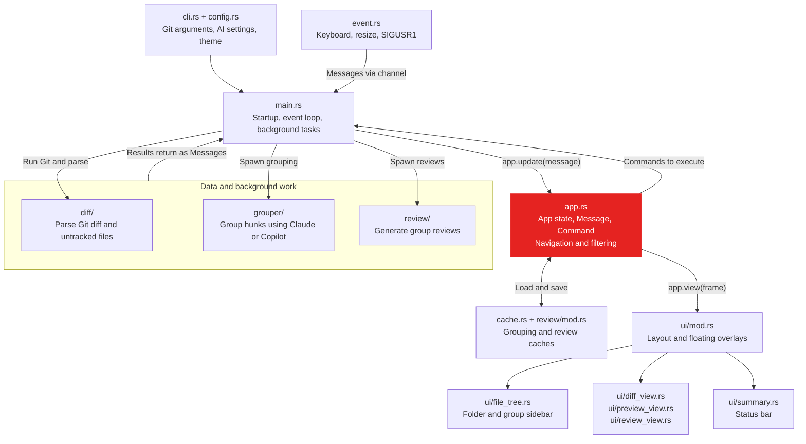
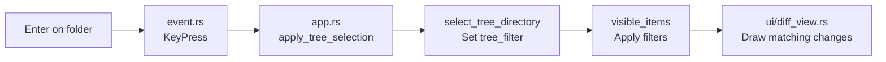

# Architecture

`semantic-diff` is a Rust terminal application built with Ratatui and Tokio.
It follows a **message → update → render** loop: input and background results
arrive as messages, application state changes, and the UI draws that state.

Start with [src/main.rs](src/main.rs) to see how everything runs, then
[src/app.rs](src/app.rs) to understand behavior. The arrows below show the
main runtime flow, rather than every Rust module dependency.

## Runtime overview



`main.rs` performs the initial Git query, creates `App`, checks grouping
caches, starts asynchronous work, and runs the terminal loop. During that
loop, `App::update` handles a `Message` and can return a `Command` for
`main.rs` to execute. Task results come back through the Tokio message
channel. `App::view` delegates rendering to `ui::draw`.

This separation is practical rather than strict: `app.rs` also accesses
caches and starts debounce timers, while startup grouping logic lives in
`main.rs` as well as the refresh handlers in `app.rs`.

## Where to make changes

| You want to change… | Start here |
|---|---|
| Startup, task execution, or shutdown | [main.rs](src/main.rs) |
| Keybindings, focus, selection, search, or state transitions | [app.rs](src/app.rs), especially `update` and `handle_key_*` |
| Sidebar folders, labels, or hierarchy | [ui/file_tree.rs](src/ui/file_tree.rs); selection behavior is in `app.rs` |
| Panel layout or floating windows | [ui/mod.rs](src/ui/mod.rs), including `render_help_overlay` and `render_settings_overlay` |
| Diff rendering or syntax colors | [ui/diff_view.rs](src/ui/diff_view.rs), [highlight.rs](src/highlight.rs), and [theme.rs](src/theme.rs) |
| Which changes Git compares | [cli.rs](src/cli.rs), especially `git_diff_args_in` |
| Parsing files, hunks, and lines | [diff/mod.rs](src/diff/mod.rs), [diff/parser.rs](src/diff/parser.rs), and [diff/untracked.rs](src/diff/untracked.rs) |
| AI grouping and incremental updates | [grouper/mod.rs](src/grouper/mod.rs); prompts and CLI invocation are in [grouper/llm.rs](src/grouper/llm.rs) |
| AI review sections and prompts | [review/mod.rs](src/review/mod.rs) and [review/llm.rs](src/review/llm.rs) |
| Markdown or Mermaid previews | [preview/markdown.rs](src/preview/markdown.rs), [preview/mermaid.rs](src/preview/mermaid.rs), and [ui/preview_view.rs](src/ui/preview_view.rs) |
| Settings and AI model selection | [config.rs](src/config.rs) |
| Grouping cache lookup and persistence | [cache.rs](src/cache.rs) |
| Terminal input and refresh signals | [event.rs](src/event.rs); PID and log paths are in [signal.rs](src/signal.rs) |

## Core data and state

The parsed diff hierarchy is defined in `diff/mod.rs`:

```text
DiffData
├── files: Vec<DiffFile>
│   └── hunks: Vec<Hunk>
│       └── lines: Vec<DiffLine>
│           └── optional word-level DiffSegment values
└── binary_files: Vec<String>
```

`SemanticGroup` values in `grouper/mod.rs` reference file paths and hunk
indices. They group existing changes by intent without replacing the parsed
diff hierarchy.

`App` holds the diff, semantic groups, navigation state, active theme,
preview and review state, caches, and handles to background tasks.
`UiState` tracks selection, scrolling, collapsed nodes, and full-file mode.

A sidebar selection becomes a `HunkFilter`: a map from file paths to hunk
index sets. An empty set means all hunks for that file. `visible_items`
produces the filtered, flattened sequence of file headers, hunk headers,
and diff lines used by the diff view.

## Example: selecting a folder



`ui/file_tree.rs` builds the nested folder tree. Keyboard input reaches
`App::update`, then the key handlers dispatch the selected node to
`apply_tree_selection`. For a directory, `select_tree_directory` keeps
descendant file paths, preserves any semantic group's hunk restrictions,
and resets diff navigation. The next frame draws the matching changes.

When investigating sidebar problems, check both the tree construction in
`ui/file_tree.rs` and the selection/filtering behavior in `app.rs`.

## Refresh and background work

Refresh is triggered by **SIGUSR1**, routed through `event.rs` and debounced
for 500 ms in `app.rs`. There is no general filesystem watcher.

The refresh path is:

```text
SIGUSR1
  → RefreshSignal
  → debounce timer
  → DebouncedRefresh
  → Command::SpawnDiffParse
  → run Git and parse tracked/untracked changes
  → Message::DiffParsed
  → update App and check grouping cache/incremental state
```

Grouping can reuse an exact diff cache, prune removed files locally, request
incremental grouping for changed files, or request a full regroup. AI
grouping and review work runs asynchronously, with results delivered as
messages. The app can display an ungrouped diff without an AI backend.

The full-file view also uses a background Git request. Request IDs let the
app reject stale full-context results while preserving navigation.

## Rendering and floating windows

`ui/mod.rs` divides the terminal into the sidebar, content area, and status
bar. The content area selects the diff, Markdown preview, or review-plus-diff
view according to application state.

Help (`?`) and settings (`,`) are floating overlays. They render after the
main content: clear a `Rect` with Ratatui's `Clear` widget, then draw a
bordered widget inside it. Add a new overlay's state and key handling in
`app.rs`, and its rendering in `ui/mod.rs`.

Markdown rendering lives in `preview/markdown.rs`. Mermaid rendering uses
the optional `mmdc` executable and supported terminal image protocols.
Pending images are flushed by `main.rs` after Ratatui draws the frame.

## Configuration and persistence

The UI also keeps bounded, in-memory caches:

- `App::visible_items` shares an `Rc<Vec<VisibleItem>>` across navigation and
  rendering. Diff updates invalidate it; filter, collapse, and full-context
  changes are checked before reuse. Cursor and scroll changes reuse it.
- Text search caches matching locations for the query and expanded search
  scope. Match counts reuse that list, and next/previous navigation uses binary
  search in document order. Collapse changes do not change the search scope.
- `ui/file_tree.rs` caches the built sidebar by diff, groups, width, and group
  color. Grouped construction indexes exact file paths and counts hunk changes
  once per rebuild.
- `preview.rs` caches one Markdown source and its parsed blocks. File path,
  size, and modification time determine whether to reread; width and theme
  determine whether to reparse. A diff refresh also clears this cache.
- `highlight.rs` loads Syntect's syntax definitions and themes once per process.

These caches are separate from the persistent AI result caches below.
Normal `App::update` flows invalidate cached data automatically. Library code
that directly mutates public diff contents must call
`App::invalidate_derived_data` afterward. Preview metadata checks avoid file
reads on ordinary redraws; edits that preserve both file size and modification
time require an explicit refresh.

- User configuration: `~/.config/semantic-diff.json`, read by `config.rs`.
- Grouping cache: `semantic-diff-cache.json` inside the repository's Git directory, managed by `cache.rs`.
- Review cache: `semantic-diff-cache/reviews/` inside the Git directory, managed by `review/mod.rs`.
- PID and logs: `$XDG_RUNTIME_DIR/semantic-diff/` when set, otherwise `~/.local/state/semantic-diff/`, managed by `signal.rs`.

## Tests to read first

Integration tests import the modules exposed by [src/lib.rs](src/lib.rs).
Many individual modules also contain unit tests.

| Area | Tests |
|---|---|
| Parsing and terminal rendering | [diff_rendering.rs](tests/diff_rendering.rs) |
| Full-file mode, stale results, and navigation preservation | [full_context.rs](tests/full_context.rs) |
| File hashes, deltas, and merging semantic groups | [incremental_grouping.rs](tests/incremental_grouping.rs) |
| Grouping responses and application state updates | [llm_integration.rs](tests/llm_integration.rs) |
| Markdown preview and scrolling | [preview_mode.rs](tests/preview_mode.rs) |
| CLI arguments and process behavior | [cli_stress.rs](tests/cli_stress.rs) |
| Signal handling and large diffs | [signal_and_stress.rs](tests/signal_and_stress.rs) |
